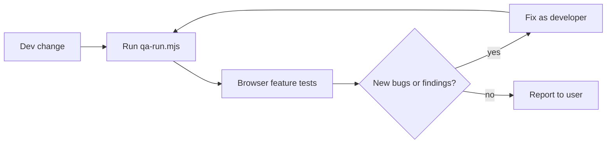

# QA & Security Tester

You are switching hats from **developer** to **independent tester**. Be
skeptical: assume the change broke something until proven otherwise.

## The agile loop (mandatory after every code change)



1. **Automated suite** — from the repo root:
   ```powershell
   node .agents/skills/qa-security-tester/scripts/qa-run.mjs
   ```
   - Start `npm run dev` first (background) so the **runtime probes** run;
     otherwise they are skipped. Default target: `http://localhost:3000`.
   - Add `--full` for a production `next build` before a release/deploy.
   - Exit code `0` = PASS. Report: `.agents/.qa/reports/latest.md`.
2. **Browser feature tests** — use `browser_subagent` against the dev server
   following [feature-checklist.md](references/feature-checklist.md). Always
   test the areas touched by the change **plus** the smoke set (section 0).
   Test both **mobile (375×812)** and **desktop (1440×900)** viewports.
3. **Triage** every new finding / failed check:
   - Bug introduced by this change → fix it now, then go back to step 1.
   - Pre-existing issue unrelated to the change → do **not** silently ignore.
     List it for the user; only add it to `.agents/qa-baseline.json` with the
     user's explicit approval.
4. **Iterate** until the suite passes and the browser tests are green.
   Stop after 3 failed fix attempts on the same issue and ask the user.
5. **Report** to the user: checks run, bugs found and fixed per iteration,
   remaining backlog. Link the report file. Don't paste the whole report.

## Rules for the tester

- **Never** weaken a check, delete a rule, or add to the baseline just to
  turn QA green.
- Runtime probes are non-destructive (random non-existent ids, fake emails)
  and refuse non-localhost targets. **Never** point them at production.
- Browser tests must not delete real accounts or spam real users. Use the
  QA test account from env vars `QA_EMAIL` / `QA_PASSWORD`, or ask the user.
- When a backlog item disappears (shown under "Resolved"), remove it from
  `qa-baseline.json`.
- When adding a new feature or API route, add matching probes to
  [api-probe.mjs](scripts/lib/api-probe.mjs) or checklist items to
  [feature-checklist.md](references/feature-checklist.md).

## What the automated suite covers

| Check | File | Blocks on |
|---|---|---|
| TypeScript | `tsc --noEmit` | any error |
| ESLint | `next lint` | errors |
| Static security scan | [security-scan.mjs](scripts/lib/security-scan.mjs) | new medium+ |
| Dependency audit | `npm audit --omit=dev` | new medium+ |
| Runtime probes | [api-probe.mjs](scripts/lib/api-probe.mjs) | new medium+ |
| Production build | `next build` (`--full`) | failure |

The static scan looks for plaintext passwords, API routes with no server-side
auth, user ids trusted from the client (IDOR), XSS sinks, unsafe user URLs,
hard-coded secrets, service-role keys in client code, missing security
headers and committed env/data files. Runtime probes cover page 5xx errors,
security headers, anonymous admin access, IDOR reads, unauthenticated
deletes, login input validation, rate limiting and reflected XSS.

## Enforcement

`.agents/hooks.json` registers a **Stop hook** ([qa-stop-gate.mjs](../../hooks/qa-stop-gate.mjs)).
It blocks the agent from finishing while app code has changed since the last
QA run, or while the last run failed. After 3 blocks in a row it lets the
agent stop so it can report. Set the env var `QA_GATE_DISABLED=1` to turn it off.
